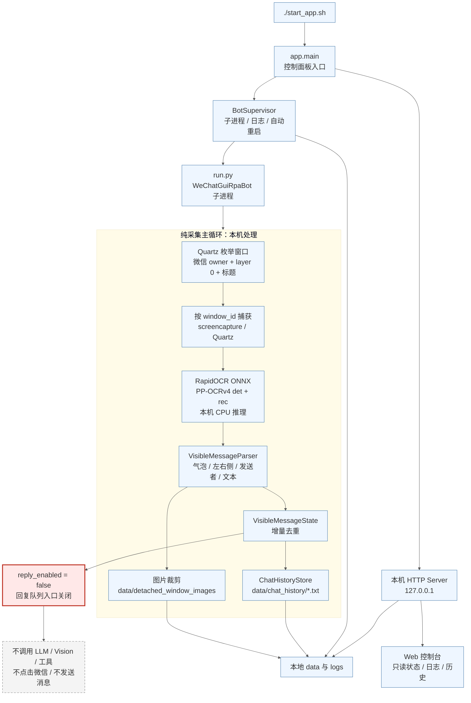
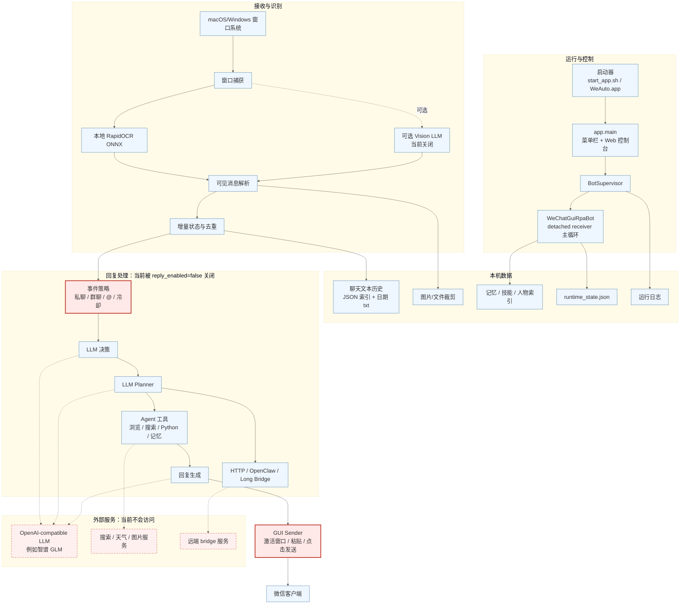

# WeAuto 运行时架构图

下面两张图都是 Mermaid 源码。相比聊天窗口里的默认渲染，这里把字号调大到 22px，并增加了节点间距。用 VS Code/GitHub/Typora 的 Mermaid 预览打开本文件即可放大查看。

## 1. 当前纯采集模式

当前本机配置为：

```toml
receiver_mode = "detached_windows"
reply_enabled = false
dry_run = true
agent_actions_enabled = false
detached_vision_parse_enabled = false

[llm]
enabled = false

[vision]
enabled = false
```

含义是：只做本机窗口捕获、本地 OCR、消息结构化、去重和本地历史保存；不进入回复决策、Agent 工具、LLM、Vision、桥接和 GUI 发送。



## 2. WeAuto 完整能力架构

这张图保留项目原本的完整处理链路，方便以后重新打开回复能力时对照。当前配置中，红色虚线右侧的外呼和发送链路不会执行。



## 3. 数据和隐私边界

| 类别 | 当前状态 | 数据去向 |
|---|---|---|
| 窗口枚举/截图 | 开启 | 本机内存与本地文件 |
| RapidOCR OCR | 开启 | 本机 ONNX Runtime CPU 推理 |
| 聊天文本历史 | 开启 | `data/chat_history/` |
| 图片裁剪 | 开启 | `data/detached_window_images/` |
| LLM / Vision | 关闭 | 不访问外部服务 |
| Agent 浏览/搜索/Python 工具 | 关闭 | 不执行 |
| GUI 回复发送 | 关闭 | 不操作微信输入框 |
| Web 控制台 | 开启 | 只绑定本机地址，Web API 只读 |

注意：聊天历史里的时间是 WeAuto 观察到消息的时间，不等于微信消息的原始发送时间。当前 GUI 截图方案无法稳定拿到微信内部消息 ID 和原始时间戳。
